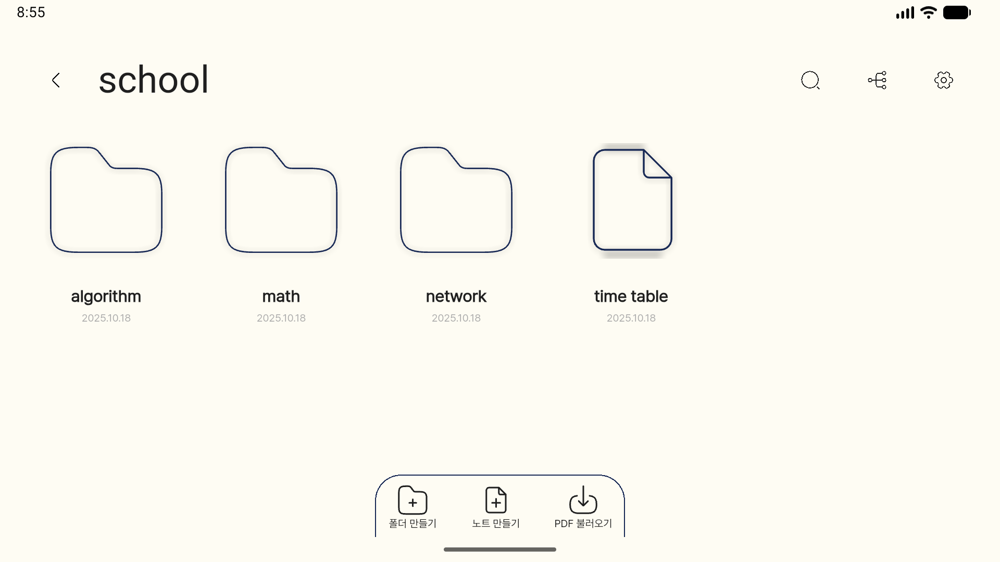
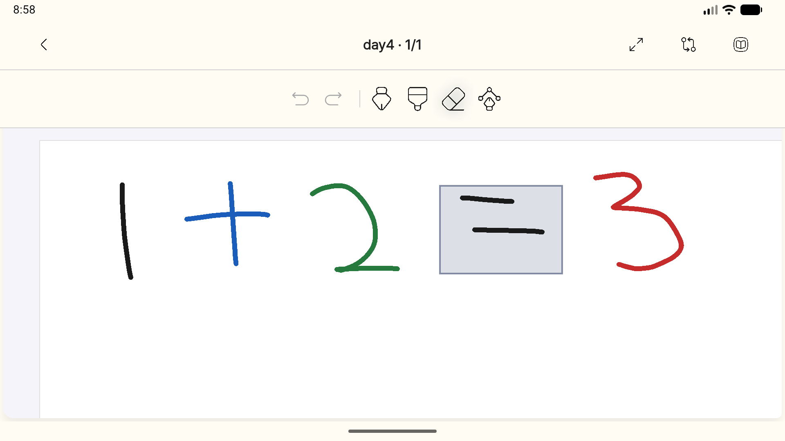
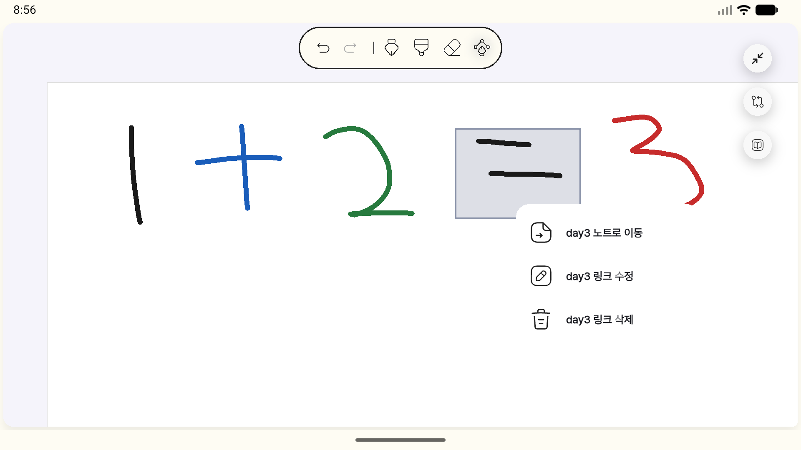
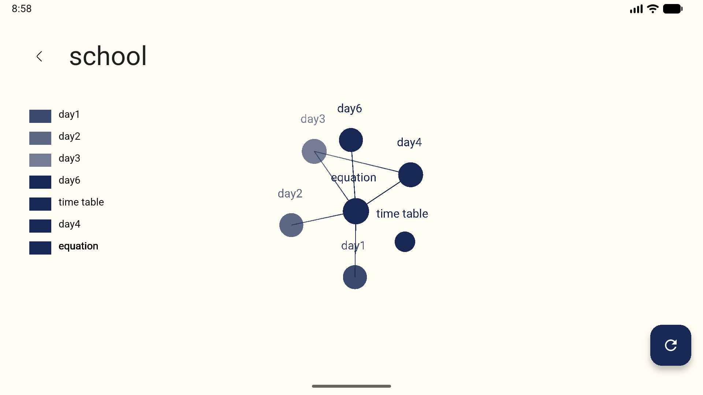

# Clustudy

손필기 노트에 링크를 걸어 노트 사이의 관계를 만들고, 그 관계를 그래프로 보며 복습하는 태블릿용 필기 앱입니다.

<a href="https://play.google.com/store/apps/details?id=com.clustudy.clustudy&pcampaignid=web_share&referrer=utm_source%3Dgithub%26utm_medium%3Dreadme%26utm_campaign%3Dproduction">
  
</a>

<!-- 데모 영상: GitHub에 업로드한 user-attachments URL을 아래 줄에 붙여 넣으면 README에서 바로 재생됩니다. -->

원본 영상 파일: [`docs/demo/demo.mp4`](docs/demo/demo.mp4)

## 목차

- [소개](#소개)
- [주요 기능](#주요-기능)
- [스크린샷](#스크린샷)
- [기술 스택](#기술-스택)
- [구조](#구조)
- [기술적 문제 해결](#기술적-문제-해결)
- [실행 방법](#실행-방법)
- [문서](#문서)
- [팀](#팀)
- [진행 과정과 결과](#진행-과정과-결과)
- [한계](#한계)
- [라이선스](#라이선스)

## 소개

수능이나 고시처럼 많은 양을 오래 누적해서 공부해야 하는 학습자는 필기가 여러 노트와 폴더에 흩어지기 쉽고, 예전에 정리한 내용을 다시 찾아 연결하는 데 시간이 많이 듭니다. 폴더 기반 필기 앱은 노트를 분류할 수는 있지만 노트 사이의 관계를 표현하지는 못합니다.

Clustudy는 손필기 위에 직접 영역을 그려 다른 노트로 가는 링크를 만들고, 어떤 노트가 현재 노트를 참조하는지(백링크)와 전체 노트의 연결 관계(그래프)를 보여 줍니다. 기존 태블릿 필기 앱 사용자가 필기 흐름을 끊지 않고 링크를 만들 수 있도록 하는 것이 목표입니다.

## 주요 기능

**필기**

- 펜, 하이라이터, 지우개, 실행 취소/다시 실행
- 필압 시뮬레이션 켜기/끄기
- 입력 방식 설정: 손가락과 펜 모두 필기 / 펜으로만 필기(손가락은 이동과 확대)
- 페이지 추가, 삭제, 순서 변경
- 전체화면 모드
- 페이지 이동이나 화면 이탈 시 자동 저장

**PDF**

- PDF를 불러와 각 페이지 위에 필기
- PDF 배경 이미지가 손상되거나 원본이 없어졌을 때 복구 옵션 제공 (다시 렌더링 / 필기만 보기 / 노트 삭제)

**링크**

- 필기 위에 사각형 영역을 그려 다른 노트로 링크 생성
- 링크를 눌러 대상 노트로 이동, 링크 수정과 삭제
- 백링크 패널에서 현재 노트를 참조하는 노트 목록 확인
- 노트나 페이지를 삭제하면 관련 링크도 함께 정리

**정리와 탐색**

- Vault(최상위 보관함) → 폴더 → 노트 계층 구조
- 노트와 폴더 생성, 이름 변경, 이동, 삭제 (이동 시 이름이 겹치면 자동으로 번호를 붙임)
- Vault 안에서 노트 이름 검색
- Vault 단위 그래프 뷰로 노트 연결 관계 시각화

## 스크린샷

<table>
  <tr>
    <td></td>
    <td></td>
  </tr>
  <tr>
    <td align="center">폴더와 노트 목록</td>
    <td align="center">필기 화면</td>
  </tr>
  <tr>
    <td></td>
    <td></td>
  </tr>
  <tr>
    <td align="center">링크 선택 시 메뉴 (노트로 이동, 수정, 삭제)</td>
    <td align="center">그래프 뷰</td>
  </tr>
</table>

전체 스크린샷(휴대폰, 7인치·10인치 태블릿)은 [`docs/screenshots/`](docs/screenshots)에 있습니다.

## 기술 스택

| 영역 | 사용 기술 | 선택 이유 |
| --- | --- | --- |
| 프레임워크 | Flutter 3.32.5, Dart 3.8 | 하나의 코드베이스로 Android와 iOS 태블릿 대응 |
| 상태 관리 | Riverpod 2 (코드 생성) | 노트·페이지별 상태를 family provider로 분리하고 생명주기를 provider에 위임 |
| 라우팅 | GoRouter | 노트 목록, 편집, 그래프, 검색 화면을 선언형으로 구성 |
| 필기 엔진 | [`scribble`](https://github.com/ehdnd/scribble/tree/fix/pointer-policy) 포크 | 손가락/펜 입력 정책과 제스처 처리를 앱 요구에 맞게 수정하기 위해 포크 |
| PDF | `pdfx` (렌더링), `pdf` (생성) | PDF 페이지를 이미지로 렌더링해 필기 배경으로 사용 |
| 로컬 DB | Isar 3 | 인덱스와 watch 쿼리로 노트·링크 변경을 UI에 바로 반영 |
| 그래프 | `flutter_graph_view` | 노트 링크 관계 시각화 |
| 분석·모니터링 | Firebase Analytics, Crashlytics | 사용 흐름 측정과 크래시 수집 |

## 구조

```
Presentation (화면, 위젯)
  → Providers / Services (Riverpod, 유스케이스 조율)
    → Repository 인터페이스
      → Isar 구현
```

- 노트 생성·이동·삭제처럼 여러 저장소(폴더 트리, 노트 콘텐츠, 링크)를 함께 바꾸는 작업은 `VaultNotesService`가 하나의 DB 트랜잭션으로 묶어 처리합니다.
- 화면은 Repository의 스트림을 provider로 구독하므로, 데이터가 바뀌면 목록, 링크, 백링크, 그래프가 함께 갱신됩니다.

```
lib/
├─ design_system/   디자인 토큰, 공통 컴포넌트, 디자인 시안 화면
├─ features/
│  ├─ canvas/       필기 편집 화면, 도구, 링크 레이어, 백링크 패널
│  ├─ notes/        노트 목록, 검색, 페이지 관리
│  ├─ vaults/       Vault 트리 저장소, 그래프 뷰
│  └─ home/         첫 화면
└─ shared/          공통 서비스, 저장소 인터페이스, Isar 엔티티와 매퍼, 라우팅
test/               lib/ 구조를 따르는 테스트
docs/               설계와 문제 해결 기록
```

## 기술적 문제 해결

**Isar 트랜잭션 중첩으로 인한 쓰기 실패**
서비스가 연 트랜잭션 안에서 각 저장소가 다시 `writeTxn`을 열어, Isar가 중첩 트랜잭션을 거부하면서 폴더 이동과 노트 생성이 실패했습니다. 서비스가 연 트랜잭션을 `DbWriteSession`으로 저장소에 전달하고, 저장소는 세션이 있으면 새 트랜잭션을 열지 않도록 바꿨습니다.
[자세히](docs/troubleshooting/isar-nested-transaction.md)

**두 손가락 확대/이동이 동작하지 않던 문제**
`scribble` 패키지가 터치 포인터를 제스처 경쟁에서 즉시 가져가서, 손가락 필기를 허용한 모드에서는 화면 확대와 이동을 담당하는 `InteractiveViewer`가 두 번째 손가락을 받지 못했습니다. 패키지를 포크해 이 모드에서는 포인터를 선점하지 않도록 고치고, 손가락이 두 개 이상일 때만 화면 이동이 켜지도록 했습니다.
[자세히](docs/troubleshooting/pointer-gesture-issues.md)

**도구를 바꾸면 실행 취소 기록이 사라지던 문제**
필기 상태 provider가 도구 설정을 `watch`하고 있어서 색이나 굵기를 바꿀 때마다 모든 페이지의 필기 상태 객체가 다시 만들어졌습니다. 도구 설정은 리스너로 반영하고, 색과 굵기 변경은 실행 취소 기록에 쌓이지 않도록 분리했습니다.
[자세히](docs/troubleshooting/undo-redo-history-loss.md)

**Vault 선택 후 노트 목록이 보이지 않던 문제**
폴더와 노트 두 스트림이 모두 값을 낸 뒤에야 결과를 내보내도록 되어 있었고, 레이아웃에서도 본문 높이가 0으로 계산됐습니다. 스트림이 시작하자마자 빈 목록을 내보내도록 바꾸고, 본문 레이아웃을 `ListView`로 바꿔 높이 문제를 해결했습니다.
[자세히](docs/troubleshooting/note-list-invisible-layout.md)

다른 문제 해결 기록은 [`docs/troubleshooting/`](docs/troubleshooting)에 있습니다.

## 실행 방법

**요구 사항**

- Flutter 3.32.5 (FVM 사용 권장, 버전은 `.fvmrc`에 고정)
- Android Studio 또는 Xcode

**설치와 실행**

```bash
git clone https://github.com/tryCatchPing/clustudy
cd clustudy
fvm install
fvm flutter pub get
```

Firebase 설정 파일(`lib/firebase_options.dart`, `google-services.json`, `GoogleService-Info.plist`)은 저장소에 포함되어 있지 않습니다. 직접 만든 Firebase 프로젝트로 설정 파일을 생성해야 빌드할 수 있습니다.

```bash
dart pub global activate flutterfire_cli
flutterfire configure
```

```bash
fvm flutter run
```

**개발 명령**

```bash
fvm flutter analyze
fvm flutter test
fvm dart run build_runner build --delete-conflicting-outputs
```

## 문서

구현 과정의 설계 문서와 문제 해결 기록은 [`docs/`](docs/README.md)에 정리되어 있습니다.

## 팀

| 역할 | 이름 | 주요 기여 |
| --- | --- | --- |
| PM, 개발 | 장태웅 | 기획 총괄, 필기 캔버스·링크·백링크·그래프·PDF·파일 시스템 구현, Isar 모델 설계와 구현, Analytics 구성, 배포 |
| 디자인, 브랜드 | 김유라 | 사용자 여정 설계, 디자인 시스템 제작, 핵심 화면과 아이콘 제작, 마케팅 에셋, QA |
| 개발 | 김지담 | 링크와 DB 구조 연구, 초기 프로토타입 |
| UI | 김효민 | 초기 기획과 디자인 프로토타입 |

## 진행 과정과 결과

- 2025.06 ~ 07: 문제 정의, 페르소나 조사, UX 프로토타입 제작
- 2025.08 ~ 09: Flutter MVP 구현 (필기 캔버스, 노트 링크, 그래프)
- 2025.10 ~ 11: 세부 기능 구현, 테스트 사용자 온보딩, 출시 준비
<!-- TODO: 공모전 정식 명칭 확인 후 수정 -->
- 결과: Google Play 출시, [공모전 이름] 대상(1위) 수상

## 한계

- 공모전 제출용 1차 MVP 범위로 개발했습니다.
- 모든 데이터는 기기에만 저장되며 클라우드 동기화나 백업 기능은 없습니다.
- PDF 내보내기는 현재 화면에 보이지 않는 페이지를 이미지로 렌더링하지 못하는 문제가 있어 앱에서 비활성화했습니다. 재설계안은 [`docs/plans/pdf-export-offscreen.md`](docs/plans/pdf-export-offscreen.md)에 있습니다.
- iOS 출시 여부는 정해지지 않았습니다.

## 라이선스

MIT License. [`LICENSE`](LICENSE)를 참고하세요.

사용한 외부 리소스:

- Pretendard Variable (SIL Open Font License 1.1): https://github.com/orioncactus/pretendard
- Play (SIL Open Font License 1.1): https://fonts.google.com/specimen/Play
- 앱 아이콘과 SVG는 팀(김유라)에서 직접 제작했습니다.
